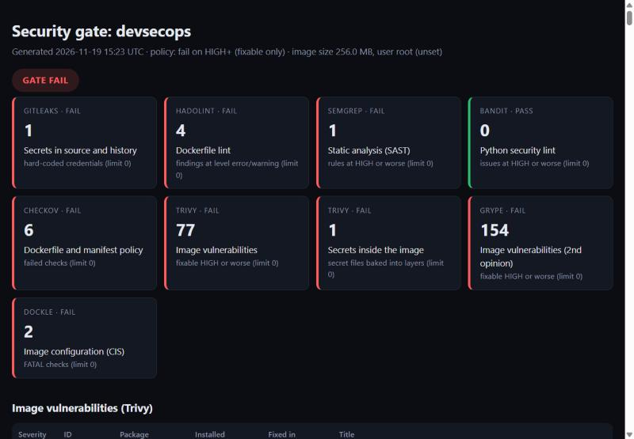

# Project 04: A CI security gate with a published report

**Tools:** Gitleaks, Hadolint, Semgrep, Bandit, Checkov, Trivy, Grype, Dockle, Syft, GitHub Actions, nginx &nbsp;|&nbsp; **Time:** 45 to 60 minutes &nbsp;|&nbsp; **Run time:** about 2 minutes

One script runs nine checks against an app, a small policy file decides PASS or FAIL,
and the same script runs on the KodeBox and in GitHub Actions. The result is an exit
code for the pipeline, SARIF files for GitHub's Security tab, a Markdown job summary,
and an HTML report served from the box on port 80.



## What you will learn

- How to combine secrets scanning, Dockerfile linting, SAST, policy-as-code and image
  scanning into one decision.
- How to write a gate policy people can live with: fixable findings only, explicit limits,
  overridable per run.
- How to publish results three ways: exit code, SARIF and a human-readable page.
- How to run the same gate locally and in CI, with pinned tool versions and actions
  pinned by commit SHA.

## Run it on the box

```bash
cd ~/devsecops-kodebox-projects
./04-ci-security-gate/gate.sh                                         # hardened app: PASS
APP_DIR=~/devsecops OUT=/tmp/gate-legacy ./04-ci-security-gate/gate.sh   # flawed app: FAIL
./04-ci-security-gate/serve-report.sh                                 # http://<box-ip>/
SITE=/tmp/gate-legacy/site ./04-ci-security-gate/serve-report.sh      # serve the failing one instead
```

## The nine checks

| # | Tool | What it looks at | Fails when |
|---|---|---|---|
| 1 | Gitleaks | Full git history (or the folder) with project 02's config | Any secret |
| 2 | Hadolint | Dockerfile | Any error or warning |
| 3 | Semgrep (`p/python`, `p/dockerfile`) | App code and Dockerfile | Any ERROR-level rule |
| 4 | Bandit | Python code | Any HIGH issue |
| 5 | Checkov | Dockerfile and project 05's Kubernetes manifests | Any failed check |
| 6 | Trivy | The built image | Any **fixable** HIGH or CRITICAL |
| 7 | Trivy secret scanner | Files inside the image layers | Any secret |
| 8 | Grype | The built image (second opinion) | Any **fixable** HIGH or CRITICAL |
| 9 | Dockle | Image configuration (CIS) | Any FATAL (after reviewed exceptions in `.dockleignore`) |

Syft also writes a CycloneDX SBOM next to the reports, so every gate run leaves an
inventory behind.

## The policy (`policy.env`)

```bash
FAIL_SEVERITY=HIGH           # vulnerabilities at this severity or worse fail the gate
ONLY_FIXABLE=true            # true: only count vulnerabilities that already have a fixed version
MAX_SECRETS=0
HADOLINT_FAIL_LEVELS=error,warning
MAX_DOCKLE_FATAL=0
SEMGREP_FAIL_SEVERITY=HIGH   # Semgrep ERROR maps to HIGH, WARNING to MEDIUM
BANDIT_FAIL_SEVERITY=HIGH
MAX_CHECKOV_FAILED=0
```

Every value can be overridden for one run: `FAIL_SEVERITY=CRITICAL ./gate.sh`. That is
how teams phase a gate in: start at CRITICAL, fix, tighten.

## Results on the KodeBox

**Hardened app (project 01):** every check passes.

```text
 Result | Tool     | Check                               | Found | Limit
--------+----------+-------------------------------------+-------+-------
 PASS   | gitleaks | Secrets in source and history       | 0     | 0
 PASS   | hadolint | Dockerfile lint                     | 0     | 0
 PASS   | semgrep  | Static analysis (SAST)              | 0     | 0
 PASS   | bandit   | Python security lint                | 0     | 0
 PASS   | checkov  | Dockerfile and manifest policy      | 0     | 0
 PASS   | trivy    | Image vulnerabilities               | 0     | 0
 PASS   | trivy    | Secrets inside the image            | 0     | 0
 PASS   | grype    | Image vulnerabilities (2nd opinion) | 0     | 0
 PASS   | dockle   | Image configuration (CIS)           | 0     | 0
GATE PASS
```

Checkov ran 90 Kubernetes checks against `05-k8s-admission-kind/manifests/allowed/app.yaml`
with zero failures.

**Flawed app (`~/devsecops`):** eight of nine checks fail. 77 fixable HIGH or CRITICAL
findings in Trivy and 154 in Grype, the token in git history and inside the image, four
Hadolint findings, and Semgrep's `missing-user` rule. Checkov flags ADD instead of COPY
(CKV_DOCKER_4), no user (CKV_DOCKER_3) and no HEALTHCHECK (CKV_DOCKER_2). Bandit passes:
its only finding, B104 (binding to all interfaces), is MEDIUM.

## Two things worth knowing

- **Write the base image out in `FROM`.** The first version of the hardened Dockerfile
  used `ARG BASE_IMAGE=...` and `FROM ${BASE_IMAGE}`. Hadolint and Docker were happy, but
  Checkov cannot resolve build arguments, so CKV_DOCKER_7 ("use a version tag") failed
  twice. Literal `FROM python:3.13-slim@sha256:...` lines fix it, and they are what
  Dependabot and Renovate need to propose base-image updates.
- **Checkov prints one JSON document per scanned folder.** `lib/kbx_reports.py` reads
  them as a stream and removes duplicates, so results from `-d app -d manifests` are
  counted once.

## The report page

`gate.py` writes `out/site/index.html` (summary cards, then Trivy, Grype, code findings
and Dockle tables). `serve-report.sh` publishes it with a deliberately hardened nginx:

```bash
docker run -d --name kbx-report -p 80:8080 \
  --read-only --tmpfs /tmp:rw,size=8m \
  --cap-drop ALL --security-opt no-new-privileges:true \
  --memory 64m --pids-limit 64 \
  -v "$SITE:/usr/share/nginx/html:ro" \
  nginxinc/nginx-unprivileged:stable-alpine
```

The KodeBox firewall opens port 80 to everyone by default. Anyone with the IP can read
the report, so restrict that rule to your own IP for anything you would not publish.

## The same gate in GitHub Actions

`.github/workflows/devsecops-gate.yml` runs on every push to `main`, every pull request,
and on demand:

1. Checkout with full history (`fetch-depth: 0`, so Gitleaks sees every commit) and
   `persist-credentials: false`.
2. `setup/install-scanners.sh` installs the same scanner versions as the KodeBox, each
   verified against the checksum file published with its release.
3. `setup/update-vuln-dbs.sh`, then `04-ci-security-gate/gate.sh`. A failing gate fails the job.
4. Always, even on failure: the Markdown summary goes to the job page, the whole `out/`
   folder is kept as an artifact for 14 days, and four SARIF files (Trivy, Semgrep,
   Gitleaks, Hadolint) go to the repository's Security tab, each with its own category.

Every action is pinned to a full commit SHA with the version in a comment. A tag can be
moved; a commit cannot.

## Try it yourself

1. Run `FAIL_SEVERITY=CRITICAL APP_DIR=~/devsecops OUT=/tmp/g ./04-ci-security-gate/gate.sh`.
   Which checks still fail?
2. Add `print(eval(input()))` to `hardened/app.py`, run the gate, and see which tools
   catch it. Revert it afterwards.
3. Open a pull request that adds a fake `kbx_` key to a file and watch the workflow fail.

## Files

| File | Purpose |
|---|---|
| `gate.sh` | Runs every scanner, then `gate.py` |
| `gate.py` | Applies `policy.env`, prints the table, writes `gate-result.json`, `gate-summary.md` and the HTML report |
| `policy.env` | The thresholds |
| `serve-report.sh` | Publishes the report on port 80 with a hardened nginx |
| `../.github/workflows/devsecops-gate.yml` | The CI workflow |
| `../setup/install-scanners.sh` | Checksum-verified scanner installs for CI |
